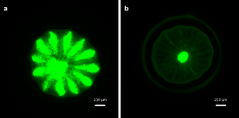

# Contrasting Larval Phenotypes in the Reef-Building Coral Stylophora pistillata: A Potential Basis for Diversified Bet-Hedging

Authors: Liel Uziahu, Elizaveta Skalon, Miri Morgulis, Noam Gazit, Zoe Diemers, Maya Ben-David, Amit Zeltzer, and Tali Mass.

Environmental variability may favor offspring with contrasting phenotypes, yet its role in coral persistence is poorly understood. We compared planulae at the high- and low-fluorescence extremes of the phenotypic range in Stylophora pistillata. High-fluorescence (HF) and non-fluorescent (NF) planulae showed no significant differences in Symbiodiniaceae read-mapping profiles but differed in morphology, physiology, tissue organization, and gene expression. HF planulae were larger, exhibited elevated green fluorescence intensity, and had lower volume-specific baseline respiration. NF planulae had a thicker ectoderm and a higher fraction of large gastrodermal vacuoles. HF larvae showed higher GFP-like and biomineralization-associated gene expression, whereas NF larvae were associated with environmental sensing and cellular stress regulation. Across separate temperature, pH, and light experiments, larval settlement did not differ consistently between phenotypes, and no individual treatment comparison was significant. Post-settlement respiration showed a phenotype-by-condition interaction only in the pH experiment. The functional absorption cross-section of Photosystem II (σPSII) was higher in HF-derived polyps under ambient conditions but higher in NF-derived polyps at 27 °C, suggesting condition-dependent photophysiological differences, whereas no differences were observed in Fv/Fm and symbiont density. These findings identify intracolonial larval variation associated primarily with host traits, some of which persist through early settlement. While consistent with diversified bet-hedging, confirming this strategy requires further investigation.

